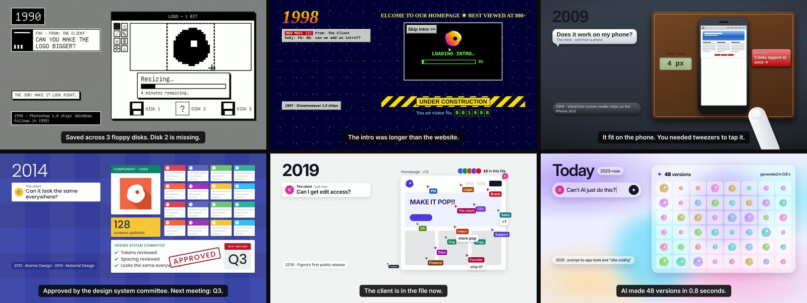

# Make the logo bigger

A 110-second animated short about how a designer's job changed between 1990 and today, told
through what a client asks for in each era. It is drawn entirely in HTML and CSS, scored with
synthesised audio, and rendered to video by stepping a headless browser frame by frame.

**[Play it in the browser](https://mehulworks.github.io/make-the-logo-bigger/)**



## The idea

One client, six eras, one request each. The request changes every time, and the answer gets
harder every time. At the end the client asks for the one thing they asked for in 1990, and
the whole film folds back on itself.

| Era | The client asks | What the designer learns |
| --- | --- | --- |
| 1990 · Pixels arrive | "Can you make the logo bigger?" | Make it look right. |
| 1998 · The wild web | "Can we add an intro?" | Make it work without seeing it. |
| 2009 · Pocket screens | "Does it work on my phone?" | Make it fit every screen and every thumb. |
| 2014 · Flat and systematic | "Can it look the same everywhere?" | Make it a system. Make it readable. |
| 2019 · Multiplayer | "Can I get edit access?" | Make it with the people it's for. |
| Today · 2023–now | "Can't AI just do this?" | Make the call. |

Each era has two beats. First the client's request and the joke in it, then someone who can't
use the result speaks up and the designer fixes it: a screen reader reading "image, image,
image" in 1998, a bus rider with one free hand in 2009, grey-on-white text nobody can read in
2014. The tools get faster in every era. The job gets bigger in every era. That is the argument.

## How it is built

The whole film is one HTML file. There is no video editor, no animation library and no
timeline application in the pipeline.

**One function drives everything.** `window.__seek(t)` puts the entire page into the state it
should be in at time `t`, then every CSS animation is pinned to that time through the Web
Animations API:

```js
for (const a of document.getAnimations()) a.currentTime = t * 1000;
```

Nothing plays in real time, so the render is deterministic: the same `t` always produces
exactly the same frame. That is what makes it filmable, and it means a dropped frame or a
slow machine cannot change the result.

**Rendering** walks the frame numbers, calls `__seek`, screenshots, and pipes the JPEGs
straight into ffmpeg, one encoded file per scene. Scenes are encoded separately so a single
era can be re-rendered without rebuilding the other seven.

**The soundtrack is synthesised from scratch** in `tools/audio.py`: one theme in C major at
120 BPM, re-orchestrated per era (chiptune, synth band, pumping pop, clean plucks, marimba
groove, ambient pads), plus about 110 sound cues built from oscillators and filtered noise.
There are no samples and no recordings in this repository, so there is nothing to license.
The cue list lives in the page itself, next to the animation it belongs to, so a timing
change moves the picture and the sound together.

**Subtitles come from the same source.** `tools/subtitles.py` writes `captions.srt` from the
page's own caption timings, so the subtitle file cannot drift out of sync with the picture.

### Build it yourself

Needs Node 18+, Python 3.10+ and ffmpeg.

```bash
npm install
pip install numpy scipy
./tools/build.sh
```

About eight minutes on two cores. Output: `out/make-the-logo-bigger.mp4`, 1920×1080, 30 fps,
−16 LUFS, plus a fresh `soundtrack.mp3` for the page.

#### Fonts

The film uses open-licensed typefaces: Inter and Poppins (the browser loads them from Google
Fonts), Unifont for 1990, and Liberation Serif, Sans and Mono for 1998, 2009 and the monospace
labels. The published video was rendered with all of them installed. Without them the page falls
back to similar system fonts, so the 1990, 1998 and 2009 eras will look a little different,
particularly on Windows and macOS.

#### How exact is a rebuild?

On one machine the build is deterministic: the same commit renders the same frames every time.
Rebuilt with Playwright's default browser, 2,080 of the published video's 3,300 frames match
pixel for pixel. The rest differ by amounts you cannot see (median 54 dB PSNR), where a symbol
character, mostly in the 1990 tool palette, falls back to a slightly different font than the
full Chrome build the film was shot with. The soundtrack and the subtitles rebuild exactly.

To watch or work on it, open `index.html` in a browser and press play. Browsers only allow
sound after a click, so the film waits behind a play button. Space plays and pauses, `R`
restarts, `1`–`6` jump between eras, `M` mutes, and `H` hides the controls.

The page plays `soundtrack.mp3`, the same mix that is in the video, and uses it as the clock:
the picture follows the sound, and is pulled back onto it whenever the two drift more than
80 milliseconds apart. In render mode (`?film=1`) the page is silent and the clock is the
frame number instead.

## Accessibility

The film argues for accessible design, so it tries to hold itself to the same standard.

- Captions are burned in at the bottom of the frame and carry every joke, because the film has
  no voiceover and feed video usually plays muted.
- `captions.srt` ships alongside it, including the spoken lines with speaker labels, so it
  doubles as a transcript.
- Every caption stays on screen at least two seconds.
- Pass and fail are marked with ✓ and ✗ as well as colour, never colour alone.
- Nothing flashes more than three times a second.
- Nothing in the film depends on sound.

## Sources

Every date and figure on screen was checked against a primary source.

| On screen | Source |
| --- | --- |
| Photoshop 1.0 ships February 1990; Windows April 1993 | [Creative Bloq](https://www.creativebloq.com/adobe/history-photoshop-12052724), [Dr. Dobb's](https://www.drdobbs.com/from-darkroom-to-desktop-how-photoshop/184412598) |
| Dreamweaver 1.0 ships 1997 | [Network World](https://www.networkworld.com/article/728042/applications-adobe-creative-suite-the-history.html) |
| WCAG 1.0 becomes a W3C Recommendation, May 1999 | [W3C](https://www.w3.org/TR/WCAG20/) |
| VoiceOver ships on the iPhone 3GS, June 2009 | [Apple Newsroom](https://www.apple.com/newsroom/2009/06/08Apple-Announces-the-New-iPhone-3GS-The-Fastest-Most-Powerful-iPhone-Yet/) |
| "Responsive web design" coined, May 2010 | [A List Apart, via Zeldman](https://zeldman.com/2010/05/25/responsive-web-design) |
| Atomic Design, 2013 | [Design Systems Collective](https://www.designsystemscollective.com/a-short-history-of-the-design-system-11aa0c277771) |
| Material Design debuts at Google I/O 2014 | [Google Design](https://design.google/library/material-design-launch-2014) |
| WCAG AA needs 4.5:1 contrast for normal text | [W3C, Understanding 1.4.3](https://www.w3.org/WAI/WCAG22/Understanding/contrast-minimum.html) |
| Figma's first public release, September 2016 | [Wikipedia](https://en.wikipedia.org/wiki/Figma) |
| WCAG 2.1 published, June 2018 | [W3C](https://www.w3.org/WAI/standards-guidelines/wcag/) |
| The European Accessibility Act applies from 28 June 2025 | [EUR-Lex](https://eur-lex.europa.eu/EN/legal-content/summary/accessibility-of-products-and-services.html) |
| 95.9% of the top million home pages have detectable failures | [WebAIM Million, 2026](https://webaim.org/projects/million/) |
| Captions were created for deaf and hard-of-hearing viewers | [NIDCD](https://www.nidcd.nih.gov/publication-products/captions-deaf-and-hard-hearing-viewers) |

The inclusion beats follow the persona spectrum from [Microsoft Inclusive
Design](https://inclusive.microsoft.design/articles/inclusive-101-guidebook): design for a
permanent need and you also serve a temporary and a situational one. That is why 2009 is a bus
rider with one hand free, and why 2014 is "anyone outdoors" as well as anyone with low vision.

The contrast numbers in the 2014 era are real: `#CCCCCC` on white is 1.61:1 and fails, and
`#595959` on white is 7:1 and passes. The 40 / 26 / 2 counts in the AI era are invented for the
story; they mirror WebAIM's 2026 rates but they are not data.

Nothing in the film is a real logo, screenshot or interface. Each era evokes its period with
original shapes, and product names appear only as plain text in the fact chips. Those product
names are the trademarks of their owners and are used here only to state facts about design
history; nothing in this film is affiliated with or endorsed by them.

## How it was made

I directed this; [Claude](https://claude.ai) wrote the code.

The concept, the structure, the six requests, the jokes, the accessibility thread and the
ending are mine, worked out over a long back-and-forth. The implementation — the markup, the
animation timing, the synthesiser, the render pipeline — was written by the model under that
direction, and reviewed, corrected and re-cut by me along the way.

[PROMPT.md](PROMPT.md) has the prompts: the finished film condensed into one prompt you can
start your own version from, and the brief the first draft was built from.
[DIRECTION.md](DIRECTION.md) has the decisions that changed it:
why the running gag was cut back, why accessibility became the spine, why the ending is a
laptop lid rather than a thrown laptop.

I am publishing the code because the interesting part of this project is not that an AI can
write CSS. It is that the thing in front of you only works because somebody decided what it
should be: which era gets which request, where the joke lands, when the caption needs another
half second, what the film is actually arguing. That is the job the last era is about.

## Licence

The code is MIT; see [LICENSE](LICENSE). Take the renderer, the synthesiser and the build
pipeline and use them for anything.

The film is not. The script, the captions, the narrative, the composed soundtrack and the
finished video are © 2026 Mehul Varshney, all rights reserved. Please don't re-release the
film itself, with or without your own name on the end card.

Typefaces are loaded from Google Fonts and are not redistributed here.

---

Directed by **Mehul Varshney**
